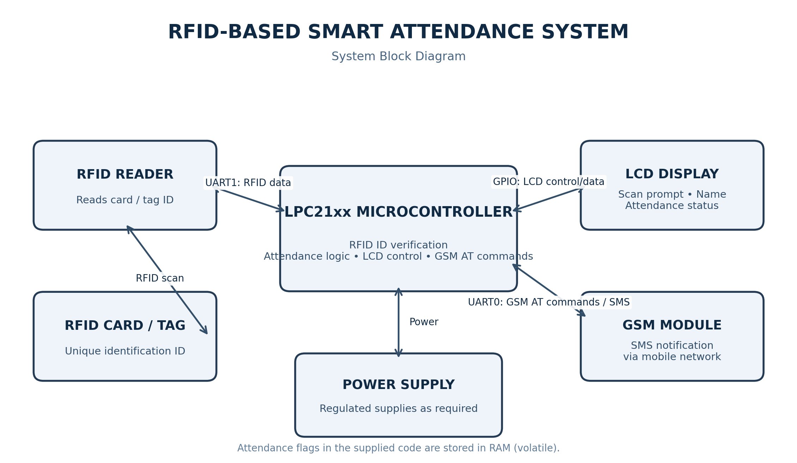

# RFID-Based Smart Attendance System with LCD Display and GSM Alert Notification

## Mini Project

An embedded-based attendance system developed using an **LPC21xx microcontroller**, an RFID reader, an LCD display, and a GSM module. The system reads an RFID card, compares its ID with the IDs stored in the program, displays the attendance status on the LCD, and sends an SMS notification to the registered mobile number when attendance is successfully recorded.

## Project Overview

The project automates attendance marking using RFID technology. Each registered person is assigned an RFID card with a unique ID. When a card is scanned:

1. The RFID reader reads the card's 12-character ID.
2. The LPC21xx microcontroller receives the ID through UART1.
3. The received ID is compared with the registered IDs stored in the program.
4. If the ID is valid and attendance has not already been marked during the current program run:
   - The person's name is displayed on the LCD.
   - An SMS notification is sent to the registered phone number through the GSM module.
   - The system records that person's attendance in a RAM flag.
5. If attendance has already been marked, the LCD displays `ALREADY MARKED`.
6. If the card ID is not registered, the LCD displays `INVALID CARD`.

## Features

- RFID-based identification.
- LCD display for user prompts and attendance status.
- GSM-based SMS notification after successful attendance registration.
- Registered ID comparison.
- Duplicate attendance checking during the current program run.
- UART serial communication with the RFID reader and GSM module.

## Hardware Components

| Component | Purpose |
|---|---|
| LPC21xx microcontroller board | Main controller; processes RFID data and controls peripherals |
| RFID reader | Reads the unique ID from an RFID card |
| RFID cards/tags | Identify registered users |
| LCD display | Displays prompts, names, and attendance status |
| GSM module with SIM | Sends attendance SMS notifications |
| Power supply | Supplies the required power to the modules |
| Connecting wires | Hardware interconnections |

> Use a GSM module and RFID reader compatible with the configured UART interfaces and logic levels. Provide suitable power supplies and level shifting where required by the module specifications.

## Software / Tools

- Embedded C
- Keil µVision (or a compatible LPC21xx development toolchain)
- LPC21xx device header
- UART communication
- LCD driver
- Timer-based delay routines

## Block Diagram



## Working Principle

### 1. System initialization
The microcontroller initializes the LCD, UART0, and UART1. It clears the RFID receive buffer and initializes the GSM module using AT commands, including SMS text mode configuration.

### 2. RFID card scanning
The LCD displays `SCAN YOUR CARD`. The RFID reader sends the card ID to the microcontroller through UART1. The program reads 12 characters into the receive buffer.

### 3. ID verification
The received ID is compared with the registered IDs in the program. The current source contains two registered entries:

| Registered name | RFID ID |
|---|---|
| PRIYA | `060067D80EB7` |
| NAGIREDDY | `0600674E6C43` |

### 4. Attendance registration
When a registered ID is detected for the first time during the current program run, the corresponding name is displayed on the LCD and an SMS is sent to that person's configured phone number.

### 5. Duplicate and invalid card handling
- **Duplicate card:** Displays `ALREADY MARKED` if the corresponding attendance flag is already set.
- **Invalid card:** Displays `INVALID CARD` if the ID does not match either registered entry.

## Communication Interfaces

| Interface | Connection / Function |
|---|---|
| UART1 | Receives RFID reader data |
| UART0 | Transmits GSM AT commands and SMS content |
| GPIO | Controls the LCD |
| Timer0 | Used by the delay routines |

## Source Code Files

| File | Description |
|---|---|
| `ATTENDANCE_MAIN.c` | Main application, RFID ID comparison, attendance logic, LCD messages, and GSM SMS handling |
| `lcd.h` | LCD initialization, command, data, string, and number display functions |
| `uart1.h` | UART1 routines used for RFID serial communication |
| `uart0.h` | UART0 routines used for GSM serial communication |
| `timers.h` | Timer0-based delay functions |

## Important Implementation Notes

- The two registered RFID IDs, names, and phone numbers are currently defined in `ATTENDANCE_MAIN.c`. Update these values to register different users.
- The `hash` array is held in RAM. Attendance flags are reset when the microcontroller is restarted; this implementation does **not** provide permanent attendance storage.
- The source currently contains two registered users. Add further entries and corresponding comparison/attendance logic to support more users.
- The RFID routine expects exactly 12 incoming characters. Confirm that this matches the output format of your RFID reader.
- UART baud-rate settings in the main source and the separate UART0 header are not identical. Ensure the UART0 baud rate matches the GSM module and the actual peripheral clock before deployment.
- Verify the GSM module's power requirements, network availability, SIM status, UART voltage levels, and antenna before testing SMS delivery.
- The delay routines should be checked on the target board: reset Timer0's counter before each timed wait so that delays are repeatable.

## How to Use

1. Connect the RFID reader to UART1 of the LPC21xx board.
2. Connect the GSM module to UART0.
3. Connect the LCD to the GPIO pins specified in `lcd.h`.
4. Insert an active SIM card into the GSM module.
5. Update the registered RFID IDs and phone numbers in `ATTENDANCE_MAIN.c`.
6. Build the project using an LPC21xx-compatible toolchain and program the microcontroller.
7. Power up the system and wait for initialization.
8. Scan a registered RFID card and check the LCD and SMS notification.

## Expected Output

| Condition | LCD / System response |
|---|---|
| System startup | `SYS IS BOOTING`, followed by GSM initialization message |
| Waiting for card | `SCAN YOUR CARD` |
| First valid scan | Displays registered person's name and sends SMS |
| Repeated scan in same run | `ALREADY MARKED` |
| Unregistered card | `INVALID CARD` |

Example SMS:

```text
YOUR PRESENCE IS REGISTERED
```

## Future Enhancements

- Store attendance records permanently using EEPROM, flash, or an external database.
- Add date and time stamping using an RTC.
- Support a larger number of registered users.
- Add an attendance export/reporting facility.
- Add administrator controls for registering and removing cards.
- Improve UART receive handling with timeouts and input validation.

## Author

**Mini Project – Embedded Systems**

---

*Note: This README describes the behavior visible in the supplied source files. Confirm the exact board, module models, wiring, and UART baud rates against your hardware before publishing a final hardware connection diagram.*
